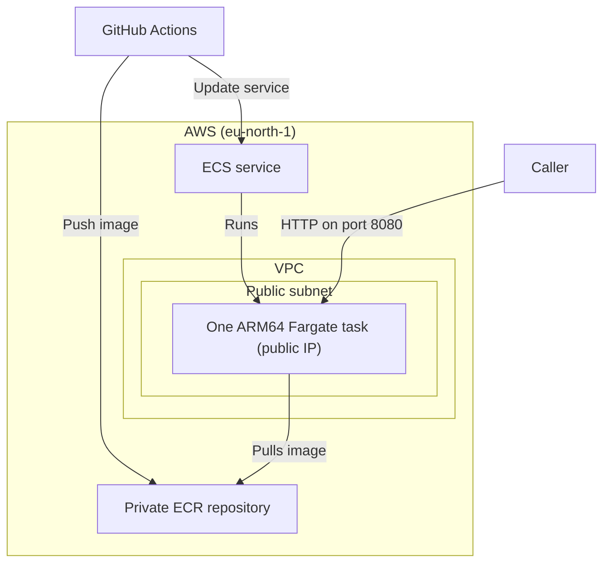
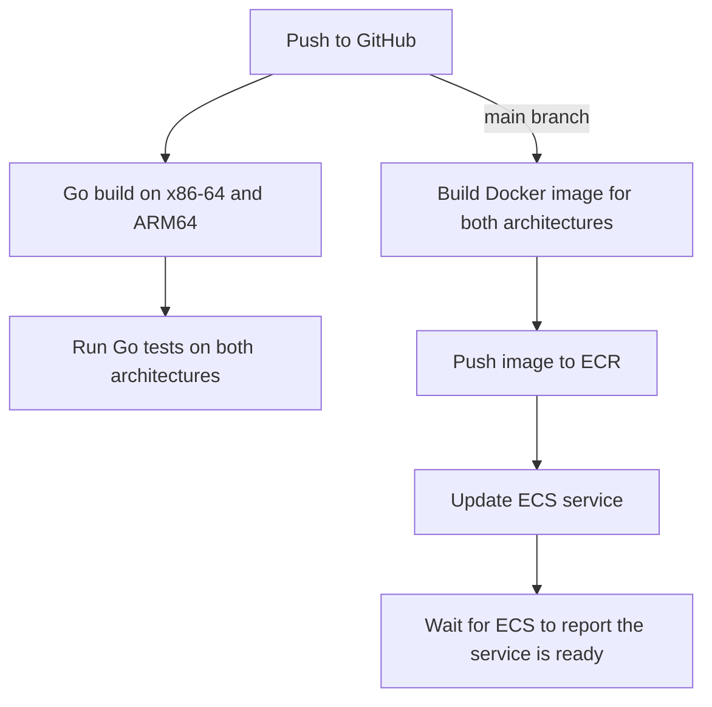

# Celtra DevOps Assignment

## Quick start

### Run with Go

Use Go 1.27.4 or newer.

```sh
PORT=8080 go run .
```

### Run with Docker

```sh
docker build -t celtra-devops .
docker run --rm -p 127.0.0.1:8080:8080 celtra-devops
```

In another terminal, request sample account data.

```sh
curl -fsS http://localhost:8080/account-123/data
```

## Account data service

### Purpose

This POC shows that the account data API can be built and tested on x86-64
and ARM64 and run on ARM64 in Amazon ECS.

### Assumptions

- The service assumes another service verifies the caller's identity and checks their access to the requested account before forwarding the request.
- The public POC returns sample data for any account ID that fits in one part of the URL.
- A deployment that serves real account data must accept requests only from the service that verifies identity and account access.

### Requirements

Serve sample account data at `GET /{accountId}/data`.

#### Acceptance criteria

A successful request returns HTTP 200 and a JSON body with these fields.

- `accountId` echoes the ID in the URL.
- `timestamp` is the time of the request in Unix seconds.
- `data` is the text `Celtra DevOps`.

### Design

A request to `/account-123/data` returns a response like this.

```json
{
  "accountId": "account-123",
  "timestamp": 1700000000,
  "data": "Celtra DevOps"
}
```

#### Tests

| Request | Expected result |
| --- | --- |
| `GET /account-123/data` | HTTP 200 with `accountId` set to `account-123`. |
| `GET /test_account_id/data` | HTTP 200 with `accountId` set to `test_account_id`. |
| `GET /42/data` | HTTP 200 with `accountId` set to `42`. |
| `GET /data` | HTTP 404 for the missing account ID. |
| `POST /account-123/data` | HTTP 404 for the unsupported method. |
| `GET /ready` | HTTP 200 with the text `Ready`. |

### Technology choices

| Technology | Role |
| --- | --- |
| Go and Gin | Handle HTTP requests. |
| Docker | Packages the app for x86-64 and ARM64. |
| GitHub Actions | Runs the build, tests, and deployment. |
| Amazon ECR | Stores the container images. |
| Amazon ECS on Fargate | Runs the service. |

### Infrastructure Setup

The AWS CLI was used to set up the network and service. GitHub Actions stores
the deployment credentials as secrets.



### Deployment flow



On `main`, deployment runs independently of the build and test workflow.
One deploy job runs at a time.

#### Release checks

- The build and tests pass on x86-64 and ARM64.
- ECS reports one healthy ARM64 task.
- `GET /ready` on the deployed service returns HTTP 200.

#### Failed deployments

If a deployment fails, ECS rolls back to the last completed deployment when one
is available. The ECS service events show the failure and any rollback.

### Trade-offs and future improvements

The single task keeps the setup small. Its public IP can change when ECS replaces
it. A production version would need a stable HTTPS address and more than one
running task.

---

### Documentation used

- https://gin-gonic.com/en/docs/routing/http-method/
- https://gin-gonic.com/en/docs/testing/
- https://docs.github.com/en/actions/tutorials/build-and-test-code/go
- https://docs.github.com/en/actions/how-tos/deploy/deploy-to-third-party-platforms/amazon-elastic-container-service
- https://docs.aws.amazon.com/AmazonECS/latest/developerguide/get-set-up-for-amazon-ecs.html
- https://docs.aws.amazon.com/AmazonECS/latest/developerguide/deployment-circuit-breaker.html
